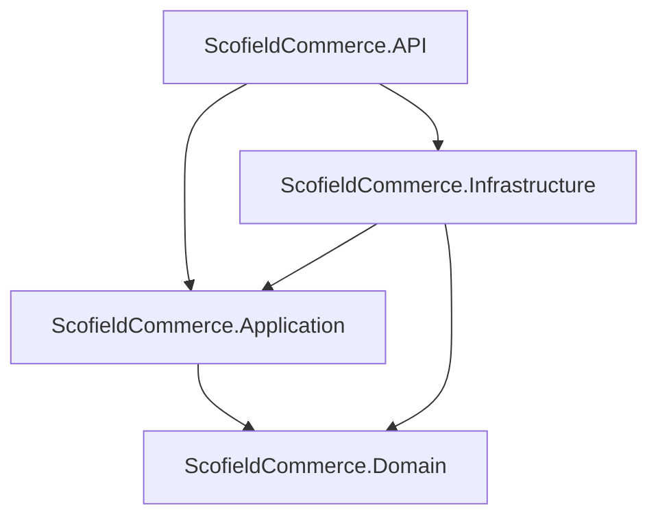

# Scofield Commerce 🚀

Sistema moderno de gestão de vendas e comissões corporativas, desenvolvido com práticas avançadas de arquitetura de software e engenharia de usabilidade. O projeto é composto por uma API robusta em **.NET 10** e uma interface web interativa em **React (Vite + TypeScript)**.

---

## 🏛️ Arquitetura do Sistema

O back-end do sistema segue os princípios da **Clean Architecture** e do **Domain-Driven Design (DDD)**, garantindo a separação de conceitos, facilidade de manutenção e alta testabilidade.

A solução está estruturada nos seguintes projetos:



1. **`ScofieldCommerce.Domain`**: O núcleo da aplicação. Contém as entidades de negócio (`Cliente`, `Venda`, `Produto`, `RegraComissao`), Objetos de Valor (`Cnpj`, `Cep`, `Endereco`) e as validações intrínsecas de domínio. Totalmente livre de dependências externas de frameworks ou banco de dados.
2. **`ScofieldCommerce.Application`**: Contém as regras de aplicação, DTOs, mapeamento e interfaces de repositórios.
3. **`ScofieldCommerce.Infrastructure`**: Responsável pela persistência e comunicação externa. Contém o `ScofieldDbContext` (EF Core), implementações dos repositórios via **Dapper** (para relatórios de alto desempenho) e **Entity Framework Core** (para operações transacionais), além das configurações de migração do banco de dados.
4. **`ScofieldCommerce.API`**: A porta de entrada do sistema. Expõe os endpoints RESTful (Minimal APIs), gerencia a injeção de dependência e as configurações gerais da aplicação.

---

## 🛠️ Tecnologias e Bibliotecas Utilizadas

### Back-end
* **Plataforma**: .NET 10.0 (C#)
* **Banco de Dados**: PostgreSQL 15 (rodando via Docker)
* **ORM e Acesso a Dados**:
  * **Entity Framework Core**: Utilizado para operações de escrita, garantindo integridade transacional e controle de concorrência.
  * **Dapper**: Empregado na camada de leitura rápida para gerar relatórios e métricas de desempenho complexas no dashboard.
* **Testes e Qualidade**:
  * **xUnit**: Framework de testes de unidade.
  * **Moq**: Biblioteca de mocks para testes isolados de serviços.
  * **FluentAssertions**: Asserções expressivas e legíveis para cenários de teste.

### Front-end
* **Framework**: React.js (com Vite como bundler)
* **Linguagem**: TypeScript para tipagem estática e segurança em tempo de desenvolvimento.
* **Estilização**: TailwindCSS para um design limpo, moderno e responsivo.
* **Gráficos e Componentes**:
  * **Recharts**: Para visualização em tempo real das evoluções de venda diárias, mensais e preferência por produto.
  * **Lucide React**: Biblioteca de ícones modernos.
  * **Axios**: Integração centralizada de requisições HTTP à API e a serviços terceiros (como a API pública do ViaCEP).

---

## 🧠 Técnicas e Padrões de Projeto Aplicados

* **Result Pattern**: Em vez de lançar exceções de negócios caras e poluir o fluxo, a API e os serviços utilizam um tipo genérico `Result<T>` ou `Result` que encapsula o sucesso da operação ou uma coleção estruturada de erros de validação.
* **Strategy Pattern com Fuzzy Matching**: Resolução de estratégias de comissão dinâmicas. As taxas de comissões são deduzidas de forma inteligente através de algoritmos de similaridade de strings baseados no nome do produto.
* **Repository Pattern**: Abstração da lógica de persistência de dados. A camada de domínio/aplicação só conhece contratos (`interfaces`), permitindo alterar a infraestrutura sem afetar as regras de negócio.
* **Value Objects (Objetos de Valor)**: Conceitos como `CNPJ`, `CEP` e `Endereço` possuem validações encapsuladas que impedem a existência de instâncias em estado inválido na aplicação.

---

## ⚡ Como Executar o Projeto

O projeto está totalmente containerizado com **Docker Compose**, simplificando a inicialização de todos os serviços.

### Pré-requisitos
* **Docker** e **Docker Compose** instalados na máquina de execução.

### Passos para Execução:

1. **Clonar e acessar o repositório**:
   ```bash
   cd scofield-commerce
   ```

2. **Subir toda a infraestrutura (Banco de Dados + API + UI)**:
   ```bash
   docker compose up --build -d
   ```
   *Este comando construirá as imagens do front-end e do back-end, baixará o PostgreSQL e iniciará as aplicações nos containers.*

3. **Verificar os endereços ativos**:
   * **Front-end (Painel Web)**: [http://localhost:5173](http://localhost:5173)
   * **Back-end (Swagger/Documentação da API)**: [http://localhost:8080/swagger](http://localhost:8080/swagger)
   * **Banco de Dados (PostgreSQL)**: Porta `5432`

4. **Desligar o ambiente**:
   ```bash
   docker compose down
   ```

---

## 🧪 Executando Testes

Caso queira rodar os testes de unidade da aplicação back-end localmente:

```bash
DOTNET_CLI_HOME=/tmp/dotnet dotnet test src/API/ScofieldCommerce.Tests/ScofieldCommerce.Tests.csproj
```

---

## 🌟 Histórico de Recursos por Versão

### 📌 Versão 1.0 - Recursos Iniciais

#### 📊 1. Painel de Controle (Dashboard)
* **Indicadores em Tempo Real (KPIs)**:
  * **Valor Total Vendido (Hoje)**: Faturamento acumulado do dia.
  * **Qtd. Produtos Vendidos (Hoje)**: Quantidade física total de itens faturados no dia.
  * **Total de Comissão (Hoje)**: Comissão gerada para os vendedores nas vendas de hoje.
* **Gráficos Analíticos**:
  * **Evolução Diária**: Gráfico de linha interativo exibindo a tendência de vendas ao longo dos dias.
  * **Comparativo Mensal**: Gráfico de barras ilustrando o volume vendido em cada mês.

#### 🛒 2. Lançamento de Vendas (Nova Venda)
* Associação rápida do cliente comprador e seleção de produtos.
* Adição múltipla de itens em tabela com cálculo automático em tempo real de subtotais e totais.
* Opções de prazo de pagamento e indicador de emissão de Nota Fiscal.
* Cálculo automatizado de comissões por regras estratégicas.

#### 📜 3. Histórico de Vendas
* Filtros de busca por **Produto**, **Cliente** e **Data**.
* Visualização detalhada (Master-Detail) com tooltip de itens e resumo financeiro.

#### 👥 4. Inteligência de Clientes (Relatório Avançado)
* **Top Clientes**: Ranking dos clientes mais valiosos com base no volume financeiro total comprado e na quantidade de vendas concretizadas.
* **Preferência de Compra**: Gráfico de rosca (*donut chart*) interativo exibindo a distribuição por produto.
* **Clientes em Risco**: Identificação de clientes inativos por período configurável (15, 30, 60 ou 90 dias) com atalho de contato por telefone.

#### ⚙️ 5. Módulo de Cadastros (Clientes e Produtos)
* **Clientes**: Preenchimento automático de endereço via API do ViaCEP ao digitar o CEP, validação de UF, CNPJ e formato de dados.
* **Produtos**: Cadastro simples de produtos e vínculo automático com regras de comissão por fuzzy matching.

---

### 🚀 Versão 1.1 - Atualizações e Novas Funcionalidades 🌟

A **Versão 1.1** introduziu uma experiência renovada para a busca e seleção de clientes, proporcionando maior praticidade no momento da venda e na consulta de informações.

#### 🔍 1. Nova Forma de Seleção de Cliente na Venda
* **Botão "Selecionar Cliente"**: O antigo campo de seleção simples foi substituído por um botão moderno e intuitivo que abre uma janela de busca avançada.
* **Busca e Seleção Rápida**:
  * Janela pop-up com a listagem completa de clientes organizados automaticamente em **ordem alfabética**.
  * Filtros dinâmicos para pesquisar clientes simultaneamente por **Nome / Razão Social** e **CNPJ**.
  * Botão de **"Limpar Filtros"** para retornar instantaneamente à lista completa.
  * Seleção prática por caixa de marcação (checkbox) com botão de confirmação.
* **Exibição do Cliente Selecionado**: Após a escolha, as informações do cliente (Razão Social e CNPJ) ficam em destaque no formulário de venda com a opção de alterar a seleção a qualquer momento.

#### 👥 2. Consulta Avançada na Tela de Clientes
* **Painel de Busca Completa**: Adicionada uma nova área na tela de *Relatório de Clientes* dedicada à consulta e filtragem da base de clientes.
* **Pesquisa Combinada**: Permite pesquisar e filtrar todos os clientes cadastrados por Nome ou CNPJ em uma visualização limpa e organizada.
* **Preservação das Ferramentas**: Todas as métricas e relatórios estratégicos já existentes (*Top Clientes*, *Preferência de Compra* e *Clientes em Risco*) foram mantidos intactos na mesma tela.